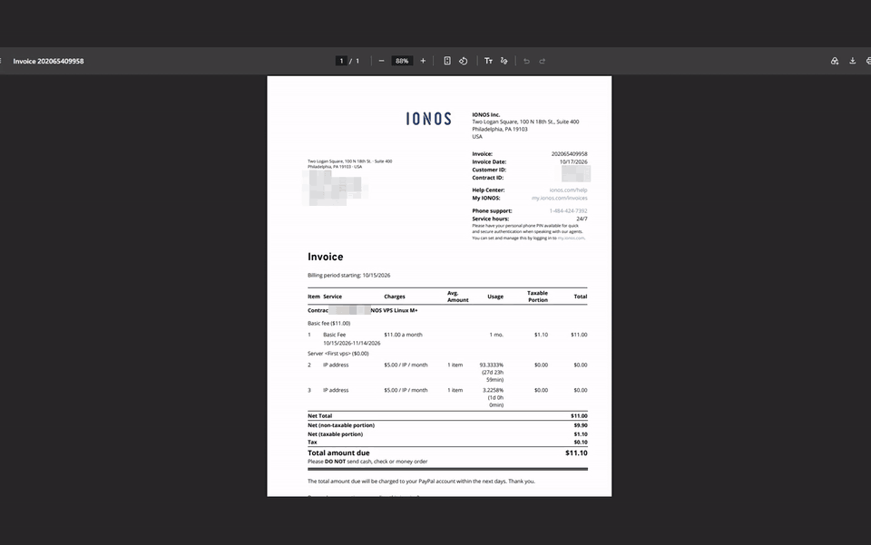
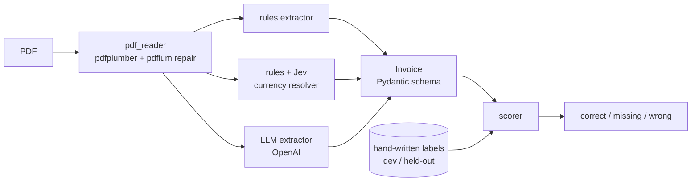

# Document Extractor

A command-line tool that pulls header fields and line items out of digital PDF invoices, into one fixed schema. It compares three ways of doing that: hand-written rules, the same rules plus a currency resolver, and an OpenAI model. Each one is scored against hand-labelled invoices.

Python · OpenAI · pdfplumber and pdfium · Pydantic · TypeSafe Jev · pytest · GitHub Actions

352 tests, ruff and mypy clean. On 67 invoices the LLM gets 468 of 469 header fields right, with none wrong.



```bash
uv run --env-file .env document-extractor extract invoice.pdf --extractor llm
```

## Why I built it

The obvious way to read invoices today is to hand them to an LLM and trust what comes back. I wanted numbers instead of trust: how much better the model really is than hand-written rules, where each approach fails, and whether a rules-first hybrid is worth building. So the scorer came first, and every extractor is judged by it the same way.

The rules behind every choice are in [docs/decisions.md](docs/decisions.md) (D1 to D34, with a one-line [index](docs/decisions-index.md)). The full results, run by run, are in [docs/comparison.md](docs/comparison.md).

## What a run looks like

1. `extract` reads the PDF's text layer and hands it to one extractor. It prints vendor, invoice number, issue date, currency, subtotal, tax, total and, for the LLM, the line items, as JSON.
2. `score` runs an extractor over a whole sample set (`dev` or `heldout`) and compares every field with the label: correct, missing or wrong.
3. It prints the counts per invoice, per field and overall, then a separate block for line items, then the time, tokens and cost of the run.

## How it's built



All three extractors have the same signature, `extract(pdf_path) -> Invoice`, so the scorer and the CLI never need to know which one ran.

## Design decisions

### Missing is null, never a guess

A wrong value is worse than a missing one. A null tells the person using the data to look; a wrong number gets paid. So every field is nullable, money is `Decimal` and must match to the cent, and the ranking counts wrong values first and missing ones second. Every way a field can come back null is listed, with the code that causes it, in [docs/null-sources.md](docs/null-sources.md) (N1 to N20).

### The held-out set never shapes a rule or a prompt

The rules and the prompt were written and tuned on `dev` only. The `heldout` invoices are scored only when asked for, for the final comparison. When a fix did come from reading held-out failures (the NUL repair below), the write-up says so, and held-out no longer counts as a clean measure of that fix.

### Ask the model for numbers, not a date string

The first LLM run got 9 of 63 dev fields wrong: every issue date had a year built from the printed day and month, so `30.04.2026` came back as 3004-04-30. Asking for year, month and day as three separate numbers fixed it, and code builds the date. It was the only time in the original comparison that any extractor gave a wrong value.

### The currency resolver only answers what the rules can't

A bare `$` could be US, Canadian, Namibian or a dozen other dollars. The rules leave it null. The Jev resolver is asked only when the page shows a bare `$` straight before a number, it never overrides a currency the rules found, and its answer is kept only at 0.8 confidence or above. That threshold came from 13 test cases, run by a live script in [scripts/](scripts/README.md).

### One module per outside dependency

Only `pdf_reader.py` imports a PDF library, only `jev.py` calls TypeSafe, and only `llm_extractor.py` imports OpenAI. Swapping any of them touches one file, and the tests fake each one at that seam.

### Line items are paired before they're scored

A model can return rows in a different order, split one row in two or invent one. The scorer pairs each extracted row with a labelled row by identical totals and identical descriptions, with page order as the tie-break. Every field of a row that doesn't pair counts against the run, so an invented row can't hide.

### Cost and time are reported, never ranked

Header extraction costs about $0.00015 per invoice and takes about 2.4 seconds, against 0.05 seconds and $0 for the rules. At that price, 10,000 invoices would cost about $1.30, so cost wouldn't decide between them at any scale this project has in view. Speed might: the LLM is about 50 times slower.

## Things that broke

Most of these came from live runs and real invoices, not from the plan.

- **NUL characters in real Stripe invoices.** The text layer held `\x00` where the page shows `-`, and the model copied it faithfully: `C7F92D63\x000001`. The reader now asks pdfium for the character at each NUL's position and puts it back. That fixed all 4 Stripe invoice numbers.
- **Brand versus legal name.** Two invoices print a short brand at the top and the registered company name lower down. The model took the brand. This was a gap in my own labelling rule, not a misreading, so I settled the rule first (the legal name wins), then stated it in the prompt.
- **The prompt was read too broadly.** "Leave out item codes and units of measure" made the model drop model numbers, sizes and pack counts from inside the description cell: 14 wrong descriptions on the first line-item run. Rewording it to mean only codes and units printed in a column of their own brought that to 1.
- **The resolver's first confident mistake.** A Mexican seller billing a US customer in `$`: the label is USD, and Jev said MXN with confidence above the threshold. Across 29 calls on the wider set it filled 27 currencies correctly, got 1 wrong and left 1 null.
- **Labels without colons.** On every Stripe invoice the rules took the `Invoice number …` line as the vendor name, because that label has no colon. Rules alone gave 23 wrong values on layouts they had never seen.

## Results

On the wider set of 67 invoices (469 header fields, 9 of them real invoices I received), after the NUL repair and the legal-name rule:

| Extractor | Correct | Missing | Wrong |
| --- | --- | --- | --- |
| llm | 468 | 1 | 0 |
| rules + Jev | 322 | 123 | 24 |
| rules | 295 | 151 | 23 |

The rules + Jev and rules rows are from before the NUL repair; rules didn't change after it, and Jev wasn't re-run because its calls are billed. Rules + Jev fills 28 more fields than rules alone, but its one extra wrong value ranks it last.

**Line items**, LLM only, three final runs on each set: 1157 to 1158 of 1160 line fields correct on dev and 709 to 710 of 712 on held-out, with none missing and every row paired. Every quantity and line total is correct in all six runs. The prompt was tuned on dev, yet held-out did about as well.

**A hybrid isn't worth building on these numbers.** Running the rules first and asking the LLM only for the fields they leave null could at best tie the LLM; it can't beat it.

All 352 tests run offline, with every network call faked.

## How I worked

I recorded each decision in the repo before building on it, with the reason and the alternatives. Each step ended with pytest, ruff and mypy clean, and the same checks now run in GitHub Actions on every push. Live, billed runs were done by hand, on a frozen commit, and every result went into the write-up with its commit hash, so each number can be traced back to the code that produced it.

---

## Setup

```bash
uv sync
uv run document-extractor --help
```

- **Python 3.13** or later. `uv sync` installs it if needed.
- **`.env`** (git-ignored) holds the keys for the billed extractors: `OPENAI_API_KEY` for `llm` and `TYPESAFE_API_KEY` for `rules-jev`. The `rules` extractor needs neither.
- Pass the file with `uv run --env-file .env ...`; `uv run` doesn't load it on its own.

## Commands

| Command | What it does |
|---|---|
| `document-extractor extract <pdf> --extractor rules\|rules-jev\|llm` | Extract one invoice and print it as JSON. |
| `document-extractor score --set dev\|heldout --extractor rules\|rules-jev\|llm` | Score a whole sample set against its labels. |

`rules` is free and makes no network calls. `rules-jev` calls TypeSafe only on invoices with a bare `$`. `llm` makes one OpenAI call per invoice.

## Samples

`samples/dev/` and `samples/heldout/` hold PDFs from two public invoice datasets, each with a hand-written `<name>.expected.json` label. Sources and licences (CC BY 4.0 and MIT) are in [samples/ATTRIBUTION.md](samples/ATTRIBUTION.md). The real invoices live in the git-ignored `samples/private/` and are not distributed.

## Tests

```bash
uv run pytest
uv run ruff check .
uv run mypy .
```

Network calls to OpenAI and TypeSafe are faked in tests. The billed live check in `scripts/` is run by hand only.

## License

Copyright (c) 2026 Yomi Lebi. All rights reserved. This code is shared for viewing only; it may not be copied, modified or reused without permission.
